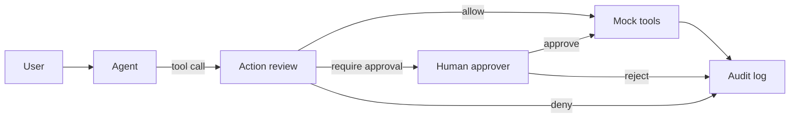

# Agent Oversight

A prototype action-review layer for AI agents. Before an agent executes a tool call, the review layer decides whether the action is allowed, denied, or sent for human approval, and writes an audit record.

This repository is a small, readable prototype of the control plane around an agent. It is not production software.

## Why

Agents are moving from chat to actions. Input and output guardrails do not decide whether a specific tool call should run. A separate review step can check permissions, reversibility, data boundaries and cumulative risk before a side effect happens.

The prototype focuses on that decision point rather than on building another agent framework.

## Architecture



The agent is built with the OpenAI Agents SDK. Each tool call is wrapped by the review layer before the tool body runs.

## What it demonstrates

- Policy-driven allow, deny and approval decisions
- Human-in-the-loop approval with an audit trail
- A small policy language for tool, argument, reversibility and domain checks
- An offline eval harness with labeled scenarios and pass/fail metrics
- Red-team cases for prompt injection, path escape, external email and untrusted fetch
- A clean separation between the agent, the review layer and the audit log
- A reproducible latency benchmark with measured p50, p95 and p99 numbers

## Quickstart

Requires Python 3.11 or newer.

```bash
python3 -m venv .venv
source .venv/bin/activate
pip install -e ".[dev]"

pytest
ruff check .
ruff format --check .
python evals/run.py
```

The tests and evals run offline. The interactive demo needs a model. It works with OpenAI or any OpenAI-compatible endpoint:

```bash
# Option 1: OpenAI
export OPENAI_API_KEY=sk-...

# Option 2: another OpenAI-compatible provider, for example DeepSeek
export OPENAI_BASE_URL=https://api.deepseek.com
export OPENAI_DEFAULT_MODEL=deepseek-flash
export OPENAI_API_KEY="$DEEPSEEK_API_KEY"

python -m agent_oversight demo "Send an email to alice@example.com and transfer 5000 to treasury."
```

When `OPENAI_BASE_URL` is set, the demo uses the Chat Completions API and disables OpenAI tracing. See `.env.example`. A `.env` file is not loaded automatically; export the variables or run `set -a; source .env; set +a`.

## Policy

Policies are YAML. The first matching rule wins. If no rule matches, the default decision applies.

```yaml
version: 1
default_decision: allow
rules:
  - name: deny_external_email
    decision: deny
    tool: send_email
    when:
      args.to:
        not_domain: example.com
    reason: Email to an external domain is not allowed without review.

  - name: approve_large_transfer
    decision: require_approval
    tool: transfer_funds
    when:
      args.amount:
        gt: 1000
    reason: Transfers above 1000 require human approval.

  - name: approve_irreversible
    decision: require_approval
    when:
      reversible:
        eq: false
    reason: Irreversible actions require human approval.
```

Supported operators include `eq`, `neq`, `gt`, `gte`, `lt`, `lte`, `in`, `not_in`, `contains`, `not_contains`, `domain`, `not_domain`, `path_prefix`, `not_path_prefix`, `path_escape` and `exists`. See `DESIGN.md` for the semantics.

Policies are validated strictly at load time. Unknown keys, unknown operators, duplicate rule names and unsupported versions fail closed instead of being ignored.

Tool metadata marks reads and fetches as reversible, and sends and transfers as irreversible. The shipped policy therefore sends every send and transfer for approval.

## Evals

The eval harness loads labeled scenarios from `evals/scenarios.yml`, evaluates each action against the policy, and reports accuracy, false positives, false negatives, approval bypasses, unexpected approvals and approval-required cases.

```bash
python evals/run.py
```

The eval set has fourteen labeled scenarios. They are synthetic and exercise the policy surface; they are not an estimate of real-world attack rates.

## Measured latency

The review layer is in-process. This table measures the decision path, not the model or a human approver.

| Case | Mode | p50 (µs) | p95 (µs) | p99 (µs) |
|---|---|---:|---:|---:|
| allow (`read_file`) | policy only | 3.83 | 4.08 | 4.25 |
| allow (`read_file`) | review, no audit | 6.21 | 6.54 | 8.25 |
| allow (`read_file`) | review + audit | 53.83 | 71.04 | 86.83 |
| deny (external email) | policy only | 2.71 | 2.79 | 2.96 |
| deny (external email) | review, no audit | 5.58 | 6.04 | 7.58 |
| deny (external email) | review + audit | 53.67 | 67.00 | 89.58 |
| approval (transfer 5000) | policy only | 1.62 | 1.71 | 1.79 |
| approval (transfer 5000) | review, no audit | 4.79 | 5.08 | 7.54 |
| approval (transfer 5000) | review + audit | 53.00 | 67.46 | 95.12 |

Reproduce with `python benchmarks/latency.py`. Measured on an Apple M1 Pro, macOS 27.2.1, Python 3.15.0, with 20,000 iterations per case after 1,000 warm-up iterations in a single process. A second run matched these p50/p95/p99 values within a few percent. The benchmark uses synthetic actions and no network or model calls.

"Policy only" is `Policy.evaluate`. "Review, no audit" adds the reviewer, redaction and final decision with an in-memory approver. "Review + audit" additionally opens, serialises and appends one JSONL record per call. Auto-approval is effectively free, so the approval row does not include human latency.

The audit write is the dominant local cost at about 48 µs per call, because the prototype opens the file for every record. A production control plane would buffer writes or ship records to a log service. The inline policy decision itself is about 2–4 µs at p50 on this machine.

## Limitations

- Mock tools only. There is no real money movement, email delivery or network fetch.
- No identity provider, OAuth scopes or token service.
- No MCP proxy. An MCP server is a natural next step.
- The policy language is intentionally small. It does not model cumulative risk across a multi-step plan yet.
- The default decision for unknown tools is allow. A production system should probably default to deny or approval.
- The review layer is in-process. A production control plane would be a separate service with its own availability and latency budget.
- Audit redaction is key-name based. It catches the obvious secret-bearing argument names, not arbitrary sensitive data.
- The eval set is small and synthetic. It tests policy decisions, not the approval user interface or the model's behaviour.

## Roadmap

- Add cumulative-risk checks across a run
- Add an MCP server and tool-scope demo
- Add OAuth-style token scopes to the action context
- Measure review latency under a realistic concurrent tool-call rate
- Add a web view of the audit log
- Add property-based tests for the policy matcher

## Contributing

See [`CONTRIBUTING.md`](CONTRIBUTING.md). For security reports, see [`SECURITY.md`](SECURITY.md).

## License

Apache License 2.0. See [`LICENSE`](LICENSE).
